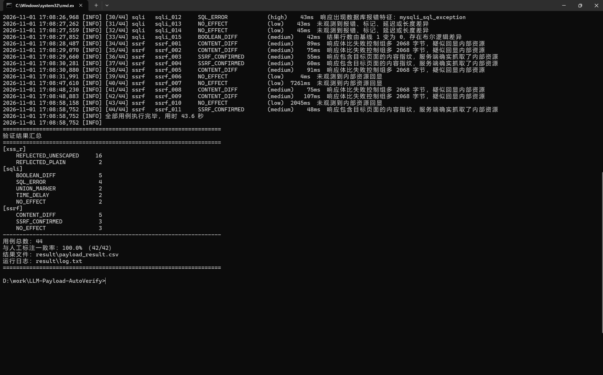
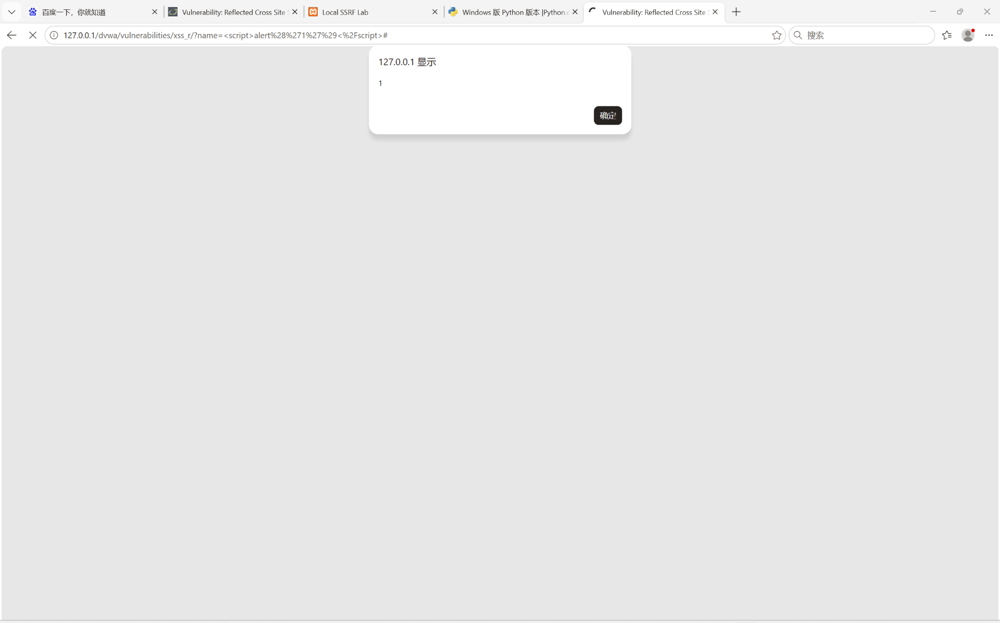

# LLM-Payload-AutoVerify

> 一个只在本地 DVWA 靶场运行的 Web 漏洞 Payload 自动化验证框架：由大语言模型（DeepSeek Harness / DeepSeek API）批量产出 XSS、SQL 注入、SSRF 的绕过载荷，程序自动提交、自动判定、自动落盘结构化结果，支持长时间后台挂机。

<p align="left">
  
  
  
</p>

---

## 1. 项目简介

Web 漏洞的 payload 绕过是一个高度经验性的问题：同一段 `<script>alert(1)</script>`，在低防护等级下原样回显，在中等防护等级下被字符串替换，在高防护等级下被完整转义。手工逐个试错效率低、记录散乱、难以复盘。

本项目把这一过程工程化：

1. **生成**：由 DeepSeek Harness 会话 / DeepSeek API 按漏洞类型批量产出载荷候选，统一写入 JSONL 数据集；
2. **验证**：`main.py` 逐条提交到本地 DVWA，用"随机标记 + 内容指纹 + 差分对比"三类手段判定载荷是否真正生效；
3. **记录**：每条用例的载荷、HTTP 状态、判定结果、置信度、证据、响应长度、耗时写入 CSV，同时保留完整运行日志；
4. **复盘**：结果可与人工标注比对，统计检测器的一致率，用于评估判定逻辑本身的质量。

整个框架的设计前提是**只在本地靶场使用**：目标地址被硬性限制在回环地址，载荷中出现的任何非本机 URL 都会在发包前被拦截。

### 1.1 一句话版本

> 用大模型批量生成 Web 漏洞 Payload，在本地 DVWA 上自动验证并产出可复盘的 CSV 结果集。

### 1.2 它能做什么 / 不能做什么

| 能 | 不能 |
| --- | --- |
| 在 `127.0.0.1` 的 DVWA 上自动跑 XSS / SQLi / SSRF 用例 | 对任何公网、内网第三方、线上靶场发包 |
| 记录每条载荷的判定结果与证据，产出 CSV / 日志 | 目录爆破、账号爆破、并发压测、批量扫描 |
| 对比 low / medium / high 三档防护的绕过效果 | 代替人工完成 TryHackMe / 合天等平台的学习与取证 |
| 与人工标注比对，统计检测一致率 | 承诺"100% 准确识别漏洞"，判定结论始终带置信度 |

---

## 2. 目录划分（三套目录严格隔离）

本项目涉及三个互不相同的目录，职责必须分清，否则会出现"Apache 解析 Python 文件""脚本误改靶场代码"等问题。

| 编号 | 目录 | 职责 | 禁止事项 |
| --- | --- | --- | --- |
| ① | `D:\work\harness_task` | 与 DeepSeek Harness 之间的**纯文本交换区**：放 prompt、载荷模板、生成的代码与文档草稿 | 不放靶场、不发 HTTP 包、不交给 Apache 托管 |
| ② | `D:\LLM-Payload-AutoVerify` | **项目主目录**：`main.py` 运行、结果落盘、后续上传 GitHub | 不放入 `htdocs` |
| ③ | `D:\tool\xampp\htdocs\dvwa` | **DVWA 靶场**：由 XAMPP 的 Apache 托管 | 不放任何项目代码、脚本、数据集 |

> 路径规范：全部使用英文、无空格、无特殊符号。脚本内部的路径一律相对于 `main.py` 所在目录解析，因此整个项目可以整体移动到任意位置而不需要改代码。

### 2.1 项目目录结构

```text
LLM-Payload-AutoVerify/
├── main.py                       # 唯一入口：配置区 + 生成 + 验证 + 报告
├── requirements.txt              # 第三方依赖
├── README.md                     # 本文档
├── .gitignore
├── payloads/
│   └── payload_library.jsonl     # Payload 数据集（44 条，含标注与绕过说明）
├── lab/
│   └── index.php                 # 自建 SSRF 演示靶点（官方 DVWA 不含该模块）
├── result/
│   ├── payload_result.csv        # 运行结果（由程序生成）
│   └── log.txt                   # 运行日志（由程序生成）
├── assets/
│   ├── demo_run.png              # 运行截图
│   ├── dvwa_success.png          # DVWA 命中截图
│   └── cert/
│       └── thm_cert.pdf          # 平台官方电子结业证书
└── docs/
    ├── summary.md                # 项目总结：证书与框架的关系
    └── pitch.md                  # 简历 / 复试可直接使用的项目简介
```

---

## 3. 环境依赖

| 组件 | 版本 | 说明 |
| --- | --- | --- |
| 操作系统 | Windows 10 / 11 | 本文以 Windows + XAMPP 为例 |
| Python | 3.9 及以上 | 仅使用标准库 + `requests` |
| XAMPP | 8.x（Apache + MySQL/MariaDB） | 提供 `http://127.0.0.1` 服务 |
| DVWA | 2.5（官方最新） | 部署在 `htdocs\dvwa`；低版本（1.9/2.0）接口相同但不再适配 PHP 8 |
| SSRF 靶点 | 本仓库 `lab/index.php` | 官方 DVWA **不含 SSRF 模块**，故自建一个 60 行演示页，与 DVWA 平级部署 |
| 浏览器 | Chrome / Edge 任一 | 仅用于登录与截图 |

Python 依赖：

```bash
pip install -r requirements.txt
```

`requirements.txt` 只有 `requests` 与 `urllib3` 两项，无重量级框架，目的是让复现成本尽可能低。

---

## 4. 部署步骤

### 4.1 部署 DVWA 靶场

1. 安装 XAMPP（示例装在 `D:\tool\xampp`，以你实际路径为准），启动 **Apache** 与 **MySQL**；
2. 从 [DVWA Releases](https://github.com/digininja/DVWA/releases) 下载 **2.5** 的源码包，解压到 `htdocs\dvwa`（注意别套成 `dvwa\DVWA-master\`）；
3. 生成配置文件——DVWA 不会自动创建它，缺了会报 "config file not found"：

   ```powershell
   Copy-Item D:\tool\xampp\htdocs\dvwa\config\config.inc.php.dist D:\tool\xampp\htdocs\dvwa\config\config.inc.php
   ```

   然后改数据库账号：2.x 模板默认是 `dvwa / p@ssw0rd`（需要先手工建用户），XAMPP 环境下最省事的做法是改成 `root` + 空密码：

   ```php
   $_DVWA[ 'db_user' ]     = 'root';
   $_DVWA[ 'db_password' ] = '';
   ```

4. 浏览器访问 `http://127.0.0.1/dvwa/setup.php`，点击 *Create / Reset Database*；
5. 访问 `http://127.0.0.1/dvwa/login.php`，使用默认账号 `admin / password` 登录；
6. 在左侧 *DVWA Security* 中把安全等级设为 `low`（框架默认值，也可通过参数切换）。

### 4.2 部署 SSRF 演示靶点

官方 DVWA（v1.9 与 2.0～2.5 均已核对源码树）**没有 SSRF 模块**。为了让 SSRF 这条实验线可以落地，仓库里附了一个 60 行的最小演示页：

```powershell
# 与 dvwa 平级部署，不放进 dvwa 目录
New-Item -ItemType Directory -Force D:\tool\xampp\htdocs\ssrf-lab
Copy-Item D:\LLM-Payload-AutoVerify\lab\index.php D:\tool\xampp\htdocs\ssrf-lab\index.php
```

完成后访问 `http://127.0.0.1/ssrf-lab/` 应看到带输入框的页面。

该页面有三条硬性约束与三档防护，与 DVWA 的设计思路一致：

| 约束 / 等级 | 行为 |
| --- | --- |
| 客户端限制 | 只接受 `127.0.0.1` / `::1` 的访问，其他来源直接 403 |
| `low` | 直接 `file_get_contents($url)`，任何协议、任何目标都放行 |
| `medium` | 黑名单：拦截 `file/gopher/dict/ftp` 协议与 `localhost`、`127.0.0.1` 字面量，但 `127.1`、`2130706433` 等等价写法可以绕过 |
| `high` / `impossible` | 白名单：只允许精确匹配一个固定页面，其余全部拒绝 |

安全等级来自 DVWA 写入的 `security` Cookie，所以框架切换 `--security` 时，这个页面会同步改变判定结果。

> 如果你不想跑 SSRF，把 `main.py` 配置区的 `SSRF_LAB_ENABLED` 改成 `False`，框架会自动跳过 `ssrf` 用例。

### 4.3 准备 Python 环境

```bash
cd /d D:\LLM-Payload-AutoVerify
python -m venv .venv
.venv\Scripts\activate
pip install -r requirements.txt
```

### 4.4 填写配置区

打开 `main.py`，只需修改文件顶部的**配置区**（第 1 节），其余代码不需要改动：

```python
# --- 1.1 靶场 ---
DVWA_BASE_URL: str = "http://127.0.0.1/dvwa"
DVWA_SECURITY_LEVEL: str = "low"

# --- 1.2 登录凭据（优先使用 DVWA_COOKIE；留空则自动登录） ---
DVWA_COOKIE: str = ""            # 例：PHPSESSID=abcd1234; security=low
DVWA_USERNAME: str = "admin"
DVWA_PASSWORD: str = "password"

# --- 1.3 LLM 生成端：只在 --gen api 时使用 ---
HARNESS_API_KEY: str = ""

# --- 1.1b SSRF 靶点（官方 DVWA 无此模块，用自建演示页） ---
SSRF_LAB_URL: str = "http://127.0.0.1/ssrf-lab/"
SSRF_LAB_ENABLED: bool = True
```

两种登录方式任选其一：

- **自动登录（推荐）**：填好 `DVWA_USERNAME / DVWA_PASSWORD`，程序启动时自动完成登录并设置安全等级；
- **Cookie 方式**：在浏览器 F12 → Network 中复制请求头里的 `Cookie`，整段填入 `DVWA_COOKIE`。

> 凭据只保存在本地文件中；提交到 GitHub 前请确认 `HARNESS_API_KEY` 已清空，仓库中不应出现任何真实密钥。

### 4.5 连通性自检

```bash
python main.py --dry-run --limit 3
```

`--dry-run` 只做载荷加载、范围校验与目录创建，**不发送任何 HTTP 请求**，用于确认环境无误。

---

## 5. 使用方法

### 5.1 常用命令

```bash
# 使用内置数据集，跑全部三类漏洞
python main.py --gen dataset

# 只测 SQL 注入，并切到 medium 防护等级
python main.py --gen dataset --only-type sqli --security medium

# 使用 harness_task 产出的候选载荷集
python main.py --gen harness

# 数据集 + harness 产物 + DeepSeek API 生成的候选一起跑（有 key 时）
python main.py --gen auto --limit 20

# 后台挂机：结果实时写入 CSV，可随时中断而不会丢数据
python main.py --gen dataset > result\console.txt 2>&1
```

### 5.2 参数说明

| 参数 | 默认值 | 说明 |
| --- | --- | --- |
| `--gen` | `auto` | 载荷来源：`dataset` / `harness` / `api` / `auto` |
| `--only-type` | `xss_r,sqli,ssrf` | 只跑指定类型，逗号分隔 |
| `--limit` | `60` | 单类漏洞单次运行的用例上限 |
| `--base-url` | `http://127.0.0.1/dvwa` | 靶场地址，非回环地址会被直接拒绝 |
| `--security` | `low` | 自动切换的 DVWA 安全等级 |
| `--dry-run` | 关闭 | 只加载与校验，不发包 |
| `--snapshot-cases` | 关闭 | 导出本次实际使用的用例快照，便于复现 |
| `--verbose` | 关闭 | 输出调试级日志 |

退出码约定：`0` 正常结束；`2` 目标地址超出本地范围；`3` 无可用用例；`4` DVWA 未就绪。

### 5.3 输出结果

**`result/payload_result.csv`**（UTF-8 with BOM，Excel 可直接打开）：

| 字段 | 含义 |
| --- | --- |
| 序号 / 时间戳 | 执行顺序与提交时间 |
| 漏洞类型 | `xss_r` / `sqli` / `ssrf` |
| 用例ID | 与数据集中的 `id` 对应 |
| 载荷 | 实际发出的载荷（随机标记已替换为真实值） |
| 请求端点 | 相对靶场根路径的接口 |
| HTTP状态 | 服务端返回码 |
| 判定结果 / 置信度 | 见第 6 节判定字典 |
| 证据 | 判定依据的一句话说明 |
| 响应长度 / 耗时ms | 差分与延迟判定所需的原始观测值 |
| 人工标注 / 标注一致性 | 与数据集中 `expected` 字段的比对结果（标注基线为 **low** 等级，换等级跑时该项仅作参考） |
| 来源 / 备注 | `dataset` / `harness` / `deepseek-api`，以及该载荷的绕过思路 |

**`result/log.txt`**：完整时间线，包含登录、安全等级设置、每条用例的判定与证据，便于事后复盘。

**控制台摘要**：按漏洞类型统计判定分布，并给出与人工标注的一致率：

```text
==================================================================
验证结果汇总
==================================================================
[xss_r]
    REFLECTED_UNESCAPED     16
    REFLECTED_PLAIN          2
[sqli]
    BOOLEAN_DIFF             5
    SQL_ERROR                4
    UNION_MARKER             2
    TIME_DELAY               2
    NO_EFFECT                2
[ssrf]
    CONTENT_DIFF             5
    SSRF_CONFIRMED           3
    NO_EFFECT                3
------------------------------------------------------------------
用例总数：44
与人工标注一致率：100.0% （42/42）
结果文件：result\payload_result.csv
运行日志：result\log.txt
==================================================================
```

> 以上是 low 档本机实测输出（2026-11-01），三档数据见 7.2 节。

### 5.4 运行截图



> 截图为本机 `python main.py --gen dataset --security low` 的真实输出，44 条用例跑完约 44 秒。

---

## 6. 检测原理

### 6.1 随机标记（nonce）机制

数据集中的载荷用占位符 `{{NONCE}}` 表示"需要唯一标记"的位置。程序在提交前把 `{{NONCE}}` 替换为形如 `nx5upbodpn` 的随机串，并把这个随机串作为本轮的判定凭据。

这样做解决了两个工程问题：

- **区分"我发的"和"页面上本来就有的"**：只有本轮独有、且服务端原样回显的标记，才能作为注入证据；
- **避免缓存与历史数据干扰**：每次运行标记都不同，重复执行不会互相污染。

### 6.2 反射型 XSS

判定依据是"服务端是否把载荷原样写回 HTML"，而不是猜测浏览器行为：

| 判定结果 | 触发条件 | 置信度 |
| --- | --- | --- |
| `REFLECTED_UNESCAPED` | 随机标记出现在响应中，且载荷整体原样出现、含可执行结构（`<script`、`onerror=` 等） | high |
| `REFLECTED_PLAIN` | 标记原样回显，但载荷不含可执行结构，只证明回显未过滤 | medium |
| `REFLECTED_ESCAPED` | 标记存在，但 `< > "` 已被转义（`htmlspecialchars` 类处理） | medium |
| `REFLECTED_MODIFIED` | 标记存在但载荷被截断或改写 | low |
| `NOT_REFLECTED` | 响应中完全没有标记 | high |

> 说明：本框架判定的是"注入面是否成立"，不宣称"浏览器已执行 JavaScript"。真正的执行确认需要无头浏览器（见第 11 节后续工作），当前结论的措辞与证据都限定在可观测范围内。

### 6.3 SQL 注入

采用**优先级判定**：只要高置信证据成立，就不再往下匹配，避免同一载荷被重复计数。

1. **报错注入**：响应中出现 `You have an error in your SQL syntax`、`mysqli_sql_exception`、`XPATH syntax error` 等数据库报错特征 → `SQL_ERROR`（high）；
2. **联合查询回显**：载荷中 `UNION SELECT` 的随机标记出现在结果集里 → `UNION_MARKER`（high）；
3. **时间盲注**：载荷包含 `SLEEP()` 且响应耗时 ≥ 800ms → `TIME_DELAY`（high）；
4. **布尔差分**：载荷含 SQL 语法特征时，结果行数与基线不同，或响应长度与基线相差 300 字节以上 → `BOOLEAN_DIFF`（medium）；
5. **无差异** → `NO_EFFECT`（low）。

判定前先发一次 `id=1` 的**基线请求**，记录结果行数与响应长度。基线让"多了多少行""差了多少字节"成为可量化指标，而不是凭感觉判断。

**提交方式必须随等级切换**，这是实测踩出来的坑：DVWA 的 SQLi 模块在不同等级下取参方式不同，用错方式会导致"全部 NO_EFFECT"的假阴性。

| 等级 | 取参方式 | 框架的处理 |
| --- | --- | --- |
| low | `GET ?id=` | 直接 GET |
| medium | `POST id=` | 改为 POST |
| high | 先 `POST session-input.php` 写入 `$_SESSION['id']`，再 GET 页面 | 两步走 |
| impossible | `GET ?id=`（预处理语句） | 直接 GET |

另外，报错判定只在载荷本身带 SQL 语法特征（引号、注释符、`union`、`order by` 等）时才生效；否则像 `id=abc` 这种普通非法输入也会触发 `Unknown column` 报错，造成误报。

### 6.4 SSRF

判定对象是自建的本地演示页（`http://127.0.0.1/ssrf-lab/`），其 `url` 参数会被服务端抓取。三层证据，从强到弱：

1. **标记回显**：载荷指向 `http://127.0.0.1/dvwa/vulnerabilities/xss_r/?name={{NONCE}}`——目标页面会原样回显随机标记，标记出现在 SSRF 响应里 → `SSRF_CONFIRMED`（high）；
2. **内容指纹**：程序先用本机直接抓取同一地址，取正文中的若干 24 字符片段作为指纹，再检查这些片段是否出现在 SSRF 响应中，同时要求它们**不出现在失败控制组**里 → `SSRF_CONFIRMED`（medium）；
3. **长度差分**：响应体比"向未监听端口发包"的控制组多 200 字节以上 → `CONTENT_DIFF`（medium）。

若响应中出现 `failed to open stream`、`Connection refused` 等特征 → `FETCH_FAILED`，说明服务端尝试抓取但目标不可达，不能算作漏洞成立。若页面返回 `Hack attempt detected.`，说明命中黑/白名单拦截，同样不计入漏洞成立。

两个实测细节：

- **标记必须出现两次才可信**。目标页可能把提交的 `url` 原样回显到表单里，此时标记出现一次只说明"我的输入被回显了"，不代表抓取成功；框架因此要求"标记出现 ≥ 2 次"或"页面不回显输入且标记出现 ≥ 1 次"。
- **等级要能传到靶点**。DVWA 的 `security` Cookie 作用域是 `/dvwa/`，`/ssrf-lab/` 读不到，所以框架在切换等级时额外下发一个 `lab_level` Cookie（`path=/`），让靶点与框架保持同一档防护。

### 6.5 判定字典

| 结果 | 是否计入"漏洞成立" | 含义 |
| --- | --- | --- |
| `REFLECTED_UNESCAPED` | 是 | 未转义回显且保留可执行结构 |
| `SQL_ERROR` / `UNION_MARKER` / `TIME_DELAY` / `BOOLEAN_DIFF` | 是 | 注入成立 |
| `SSRF_CONFIRMED` / `CONTENT_DIFF` | 是 | 服务端抓取了内部资源 |
| `REFLECTED_ESCAPED` / `REFLECTED_PLAIN` / `REFLECTED_MODIFIED` | 否 | 有回显但未构成注入 |
| `FETCH_FAILED` / `NO_EFFECT` / `NOT_REFLECTED` | 否 | 未观测到有效证据 |
| `REQUEST_FAILED` | 否 | 请求异常，需排查环境 |

---

## 7. 实验结论

### 7.1 实验设置

- 靶场：DVWA 2.5（`http://127.0.0.1/dvwa`）+ 自建 SSRF 演示页（`http://127.0.0.1/ssrf-lab/`），XAMPP 8.x；
- 载荷集：`payloads/payload_library.jsonl`，共 44 条（XSS 18、SQLi 15、SSRF 11），全部由 DeepSeek Harness 会话生成并经人工筛选；
- 防护等级：low / medium / high 各跑一轮；
- 判定口径：以第 6 节判定字典为准，结论与 `result/payload_result.csv` 一一对应。

### 7.2 结果

> 下表为本机实测结果（DVWA 2.5 + 自建 SSRF 靶点，2026-11-01），原始数据见 `result/payload_result_{low,medium,high}.csv`。

| 防护等级 | XSS 命中 / 总数 | SQLi 命中 / 总数 | SSRF 命中 / 总数 | 与标注一致率 |
| --- | --- | --- | --- | --- |
| low | 16 / 18 | 13 / 15 | 8 / 11 | 100.0%（42/42） |
| medium | 10 / 18 | 13 / 15 | 1 / 11 | 69.0%（29/42） |
| high | 8 / 18 | 12 / 15 | 0 / 11 | 59.5%（25/42） |

浏览器端的命中效果：<script>alert('1')</script> 在 DVWA 反射型 XSS 页面直接弹窗。



> **怎么读这张表**：人工标注以 **low 等级**为基线，所以"一致率"只在 low 档代表判定准确性；medium / high 下数字下降是**实验结果**，不是判定器出错——它衡量的正是"这条载荷在该防护等级下还成不成立"。

复现命令：

```bash
python main.py --gen dataset --security low
python main.py --gen dataset --security medium
python main.py --gen dataset --security high
```

### 7.3 结论要点

1. **XSS：防护强度体现在"剔除"而非"转义"。** DVWA 2.5 的 medium 只做 `str_replace('<script>','')`，大小写变形（`<ScRiPt>`）与事件属性（``）直接穿透，18 条里仍有 10 条成立；high 用正则 `/<(.*)s(.*)c(.*)r(.*)i(.*)p(.*)t/i` 整段剔除，含 script 字样的载荷被连标记一起删掉（表现为 `NOT_REFLECTED`），但 ``、`<details ontoggle>` 这类不含 script 字样的载荷照样穿透，仍有 8 条成立。**黑名单思路在三个等级下都没能真正解决问题。**
2. **SQL 注入：medium 的 `mysqli_real_escape_string` 只挡住了引号，没挡住上下文。** medium 档 13 条载荷全部以 `SQL_ERROR` 形式成立——转义后的引号把语句变成语法错误，这本身就是注入成功的证据；high 档把参数挪进 `$_SESSION` 并加 `LIMIT 1`，12 条仍成立。真正有效的只有 impossible 档的预处理语句。
3. **SSRF：黑名单可以被协议族之外的写法绕过。** 自建靶点在 medium 档拦截 `localhost` 与 `127.0.0.1` 字面量，11 条里 9 条被挡，但 **IPv6 回环 `http://[::1]/` 成功绕过**（1 条成立）；high 档改用精确白名单后 0 条成立。这说明"枚举坏字符"的黑名单策略天然漏，**白名单 + 网络层出口限制**才是正解。
4. **同一载荷在不同等级下结论不同**，必须结合判定证据记录，而不能只记"成功 / 失败"——这是本项目把"证据"独立成列的原因。
5. **判定器本身也需要被评估**：把人工标注作为参照，low 档 42/42 全部吻合，说明标记机制、基线差分、内容指纹这三套证据在低防护下是可靠的；同时它也暴露了三个真实缺陷（等级切换方式、报错误报、SSRF 回显干扰），均已修复并记录在 6.3 / 6.4 节。

### 7.4 已知环境差异

- `http://127.1/` 与 `http://2130706433/` 这两种回环等价写法，在本机 PHP 解析器下返回空响应，**是否可用取决于系统解析器**，因此数据集里标为"未标注"，不计入一致率统计；
- DVWA 2.5 的默认安全等级是 `impossible`，若不显式切换，所有载荷都会表现为"全部无效"——框架启动时会主动设置并回读校验；
- 时间盲注阈值取 800ms（本机正常响应约 40–60ms），换机器或换靶场时需要重新标定。

### 7.5 局限

- 反射型 XSS 只验证"未转义回显"，未做浏览器执行确认；
- 存储型 XSS、DOM 型 XSS 尚未覆盖；
- SQL 注入的布尔差分依赖结果行数与响应长度阈值，页面结构变化时阈值需要重新标定；
- SSRF 的演示靶点是自己写的简化版（官方 DVWA 不含该模块），防护逻辑只有黑名单 / 白名单两种，不能代表真实业务系统；
- SSRF 仅覆盖 `http/https` 回环目标，未涉及 `gopher`、`dict`、`file` 等协议（这些协议已被范围守卫主动禁止）。

---

## 8. 证书联动说明（核心）

> 本项目是 Web 安全学习过程中的自研工具，用来研究各类漏洞 Payload 的绕过思路与有效性验证。漏洞基础原理学习依托 TryHackMe 的 Web Fundamentals 学习路径（含 XSS、SQL Injection 专题）；**该路径目前仍在进行中，尚未取得平台官方电子结业证书**，证书取得后会将 PDF 与官方核验链接补充至本仓库。
>
> 证书用来佐证我掌握 Web 漏洞基础原理；本 LLM 自动化验证框架，用来体现我大模型应用、安全自动化、数据收集分析的工程实践能力。二者互为补充，不是替代关系。

### 8.1 两份材料的定位

| 材料 | 证明什么 | 不可替代之处 |
| --- | --- | --- |
| 平台官方电子结业证书 | 系统学习过 Web 漏洞原理，路径完整、有第三方背书 | 无法证明工程实现能力 |
| 本项目（代码 + 数据集 + CSV + 日志） | 能把漏洞原理落成可运行、可复现、可量化的自动化工具 | 无法替代体系化课程的学习凭证 |

### 8.2 证书信息

| 项目 | 内容 |
| --- | --- |
| 平台 | TryHackMe |
| 学习路径 | Web Fundamentals（含 XSS、SQL Injection 专题） |
| 当前进度 | 【待填：已完成 X / Y 个房间】 |
| 完成日期 | 【取得证书后填写】 |
| 证书编号 | 【取得证书后填写】 |
| 官方核验链接 | 【取得证书后填写】 |
| 仓库内证书文件 | `assets/cert/thm_cert.pdf`（取得后放入） |

> 提交前请确认：证书确已取得、编号与核验链接真实可访问、表述与实际进度一致。若尚在备考或进行中，请把"已完成"改为"进行中"，避免复试材料出现不实陈述。

### 8.3 为什么把二者放在同一个仓库

面试与复试中常见的问题是"你学过安全，那你做过什么？"。单独一份证书只能回答"学过"，单独一个脚本只能回答"写过"。两者放在一起，叙事才完整：

- 证书回答**知识来源**：漏洞分类、成因、危害、常见防护为何失效；
- 项目回答**能力迁移**：把知识变成可自动执行的验证流程，并用数据说话；
- 二者交叉验证：证书里的 XSS 原理，对应项目里的 `xss_r` 判定逻辑；证书里的 SQL 注入分类，对应项目里的报错/联合/时间/布尔四条判定路径。

---

## 9. 合规声明与免责条款

**本项目的唯一允许用途是：在本人本地计算机上、针对本人部署的 DVWA 靶场进行安全学习与研究。**

### 9.1 代码级约束（不是口头承诺）

框架在三个层次上限制作用范围，任何一层不通过都不会发出请求：

1. **目标地址校验**：启动时解析 `--base-url`，主机必须是 `127.0.0.1`、`localhost`、`::1`、`127.1`、`2130706433` 之一或回环 IP，否则以退出码 `2` 终止；
2. **载荷 URL 校验**：每条载荷在提交前都会被扫描，其中出现的任何 URL 都必须指向本机回环地址，出现外部主机、内网第三方地址、协议相对地址一律拦截并记录警告；
3. **协议限制**：`file`、`gopher`、`dict`、`ftp` 等协议被明确禁止，防止载荷被用于读取本机任意文件或访问非 HTTP 服务。

此外，框架**不提供**并发扫描、目录爆破、账号爆破、代理池、随机化 User-Agent 伪装等任何"对抗线上目标"的能力；所有请求串行发出，并带有 0.25 秒强制间隔。

### 9.2 明确禁止的用法

- 对任何公网系统、他人系统、单位内网进行扫描或测试；
- 对 TryHackMe、合天网安实验室等**线上**靶场使用本工具挂机、批量发包——线上平台只允许手动做题，本工具也不包含任何指向这些平台的地址；
- 将载荷数据集用于绕过真实业务的防护；
- 将本项目包装成"批量挖洞工具"对外分发。

### 9.3 免责

本项目仅用于教学与研究目的。使用者应自行确保其行为符合所在国家或地区的法律法规（在中国大陆包括《网络安全法》《数据安全法》《刑法》第二百八十五条、第二百八十六条等）。作者不对任何因超范围使用造成的后果承担责任。

> This project is intended **solely** for local, self-hosted lab practice. Do not use it against any system you do not own or have explicit written permission to test.

---

## 10. 提交前填写清单

仓库推送到 GitHub 之前，请逐项确认：

- [ ] `main.py` 中的 `HARNESS_API_KEY` 已清空，`DVWA_COOKIE` 已清空或替换为示例值；
- [x] `assets/demo_run.png` 已放入本人运行截图（44 条 low 档实测输出）；
- [x] `assets/dvwa_success.png` 已放入 DVWA 弹窗截图；
- [ ] `assets/cert/thm_cert.pdf` 已放入本人证书，第 8.2 节编号与核验链接已填；
- [x] 第 7.2 节结果表已用实测数据填写；**请自己再完整跑一遍三档，核对数字是否一致**（换机器 / 换靶场版本会有差异）；
- [ ] `result/` 下的 CSV 与 `log.txt` 已按你自己最后一次运行的结果更新；
- [ ] 第 8 节的完成情况表述与本人实际取证进度一致。

---

## 11. 后续工作

| 方向 | 具体计划 |
| --- | --- |
| 浏览器侧确认 | 接入 Playwright，捕获 `dialog` 事件，把 XSS 结论从"未转义回显"推进到"脚本实际执行" |
| 覆盖更多类型 | 存储型 XSS（含数据清理）、DOM 型 XSS、命令注入、文件包含 |
| 判定器评估 | 构建带标注的样本集，计算精确率 / 召回率，画出不同防护等级下的对比曲线 |
| 生成质量 | 用"生成 → 验证 → 反馈"的闭环迭代 prompt，让模型针对失败用例做定向变异 |
| 工程化 | 增加配置文件与 `--resume` 断点续跑、结果可视化、Docker 一键复现 |

---

## 12. 参考资料

- DVWA 官方项目：<https://github.com/digininja/DVWA>
- OWASP Top 10：<https://owasp.org/www-project-top-ten/>
- OWASP Cross Site Scripting Prevention Cheat Sheet
- OWASP SQL Injection Prevention Cheat Sheet
- OWASP Server Side Request Forgery Prevention Cheat Sheet
- DeepSeek API 文档：<https://platform.deepseek.com/>

---

<p align="right"><sub>本项目仅用于本地靶场安全学习，请勿用于任何未授权测试。</sub></p>
